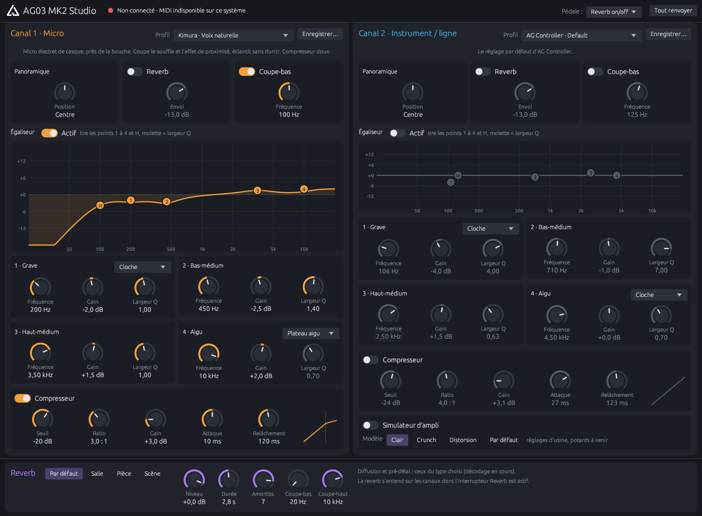

# AG03 MK2 Studio

Logiciel libre de contrôle de la **Yamaha AG03 MK2**, en Rust. Testé sous Windows ; la version Linux
compile mais n'a pas encore été testée avec le boîtier.
Une alternative à AG Controller : tous les réglages en une seule vue, en français, avec des potards,
des profils prêts à l'emploi et des valeurs saisissables au clavier.



## Ce qu'il fait

- **Canaux 1 et 2** : panoramique, envoi reverb, coupe-bas, égaliseur 4 bandes avec courbe interactive
  (on tire les points à la souris), compresseur avec sa courbe.
- **Calcul identique à AG Controller** : les coefficients DSP (EQ, coupe-bas, compresseur, filtres et amortissement
  de la reverb) sont recalculés exactement comme lui, vérifiés à l'octet près sur ses presets.
- **Profils** : voix (micro de casque, micro dynamique), guitare acoustique, neutre, réglage d'usine,
  et profils personnels enregistrables.
- **Ampli du canal 2 et types de reverb** : modèles d'usine d'AG Controller.
- **ag03ctl** : un outil en ligne de commande pour scripter les réglages.

Le protocole, retrouvé par rétro-ingénierie (captures MIDI et analyse d'AG Controller), est documenté dans
[`PROTOCOLE.md`](PROTOCOLE.md).

## Installer

- **Windows** : télécharger l'installeur dans [Releases](../../releases). Le pilote « Yamaha Steinberg USB Driver »
  doit être installé.
- **Linux** : pas encore testé avec le boîtier. On peut compiler (voir plus bas) ; les retours sont bienvenus.

Au premier lancement, l'appli envoie tous ses réglages au boîtier : c'est elle qui fait foi.

## Compiler

Avec Rust (https://rustup.rs) : `cargo build --release`. Sous Linux, il faut aussi les paquets de développement
ALSA et X11/Wayland (Debian/Ubuntu : `libasound2-dev libxkbcommon-dev libwayland-dev libgl1-mesa-dev`).

Ce qui reste à faire : réglage fin de l'ampli, diffusion et pré-délai de la reverb, vumètres.

---

# ag03ctl (ligne de commande)

## Lancer

1. Installer Rust : https://rustup.rs (une fois).
2. Dans ce dossier : `cargo build --release`
3. L'exécutable est dans `target\release\ag03ctl.exe` (les exemples ci-dessous l'appellent `ag03ctl`).

Par défaut l'outil **n'envoie rien** : il affiche les messages. Ajouter `--send` pour les envoyer.
AG Controller peut rester ouvert (le port MIDI accepte plusieurs programmes), mais son affichage ne suivra
pas forcément les changements faits avec ag03ctl.

## AG03 MK2 Studio (l'appli graphique)

`cargo build --release` produit aussi `target\release\ag03studio.exe` : tous les réglages en une seule fenêtre,
avec des potards, la courbe d'EQ (on peut tirer les points 1 à 4 et H à la souris, la molette règle la largeur Q)
et des profils prêts à l'emploi (Kimura, PodMic, guitare acoustique, neutre, Default d'AG Controller).

- Potards : glisser (Maj = réglage fin), molette, double-clic = valeur par défaut.
- Les réglages partent en direct vers le boîtier. À la connexion, l'appli envoie **tout son état** :
  c'est elle qui fait foi, pas ce qui était réglé avant dans AG Controller.
- Profils perso : bouton « Enregistrer… ». Ils sont stockés dans `%APPDATA%\AG03Studio\profils.json`,
  et le dernier état dans `etat.json` (repris au lancement suivant).
- À vérifier à l'oreille : les interrupteurs Égaliseur et Coupe-bas du canal 2 ont une adresse déduite,
  pas encore capturée.

## Exemples

```powershell
ag03ctl list                                  # ports MIDI (chercher « AG03 »)
ag03ctl monitor 10                            # écoute le boîtier 10 s

ag03ctl set ch1-rev-send -12 --send           # REV SEND du canal 1 à -12 dB
ag03ctl set reverb-level 0 --send             # LEVEL de la reverb à 0 dB
ag03ctl pan ch2 -0.5 --send                   # PAN du canal 2 à moitié à gauche
ag03ctl switch ch1 off --send                 # coupe la reverb du canal 1 (= bouton REVERB)

ag03ctl toggle ch1-comp on --send             # compresseur du canal 1
ag03ctl amp on --send                         # AMP SIM du canal 2
ag03ctl amp-type high --send
ag03ctl footswitch ch1-mute --send            # la pédale coupe le canal 1

ag03ctl eq ch1 high highshelf 8000 3 --send   # aigus +3 dB à partir de 8 kHz
ag03ctl eq ch1 midlow bell 400 -3 2 --send    # creux de 3 dB à 400 Hz, Q 2
ag03ctl hpf ch1 80 --send                     # passe-haut à 80 Hz
ag03ctl comp ch1 -18 3 2 35 218 --send        # THRESH RATIO GAIN ATTACK RELEASE

ag03ctl presets ch1                           # liste des 21 presets voix
ag03ctl preset ch1 "middle / sing (micro statique)" --send
ag03ctl preset ch2 crunch --send
ag03ctl preset reverb hall --send
```

## Limites actuelles

- EQ, passe-haut et compresseur : réglage libre, calcul identique à AG Controller (vérifié à l'octet près
  sur les presets d'usine). Seule différence : AG Controller arrondit le RELEASE à ses crans, ag03ctl non.
- AMP SIM et paramètres de reverb : réglables **via les presets** seulement pour l'instant.
- Charger un preset du canal 1 remet aussi son PAN et son REV SEND, comme dans AG Controller.

## Tests

`cargo test` vérifie l'encodage contre des messages réellement capturés, et le chargement des 31 presets.

## Installeur Windows

Une fois pour toutes : `winget install JRSoftware.InnoSetup`. Puis, dans ce dossier :

```powershell
powershell -ExecutionPolicy Bypass -File installeur\construire.ps1
```

Le script compile, signe les exécutables au nom de Lopjoy, crée l'installeur dans `dist\` et le signe.
L'installeur ne demande pas de droits administrateur (installation dans le profil), crée les raccourcis
et propose l'outil en ligne de commande en option.

Signature : sans certificat acheté, un certificat auto-signé « Lopjoy » est créé. Les fichiers portent bien
la signature Lopjoy, mais Windows SmartScreen avertira les autres utilisateurs tant que le certificat
ne vient pas d'une autorité reconnue (certificat de signature de code, ou Azure Trusted Signing).

## Licence

Copyright 2026 Lopjoy. Distribué sous licence Apache 2.0 : voir `LICENSE` et `NOTICE`.

Yamaha, AG03 et AG Controller sont des marques de Yamaha Corporation. Ce projet est indépendant :
il n'est ni affilié à Yamaha ni approuvé par Yamaha.
